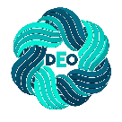
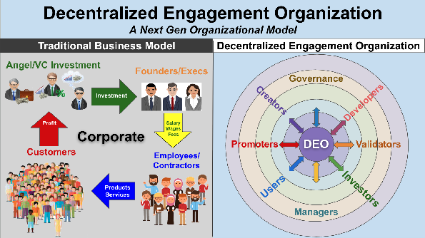

<!--
Source: "White Paper: The Decentralized Engagement Organization" (Dane v2),
Google Doc https://docs.google.com/document/d/1SBPc4KvtswQlbYTkd9ynov-PEA99kLo34N0Ztr12qm8
Copied word for word on 2026-10-30, 2:45 PM Mountain time, by Google Docs' own Markdown export.
The only change: the two pictures are stored beside this file, the cover logo as deo-logo.png and the section 3 diagram as deo-model-diagram.png.
Made public by Dane, 2026-10-30. Edit the Google Doc first; this copy follows it.
-->

# **White Paper:**

# **The Decentralized Engagement Organization (DEO)**

## **A Framework for Building Organizations on Human Coordination Rather Than Capital**

**Written by** 

**Dane Christensen**

**with Claude Fable**

**July 2026**

## **Abstract**

This paper defines the Decentralized Engagement Organization (DEO): an organizational structure in which human engagement — rather than capital investment — is the founding resource, the operating fuel, and the ultimate purpose of the enterprise. 

A DEO is built atop a [Decentralized Autonomous Organization](https://en.wikipedia.org/wiki/Decentralized_autonomous_organization) (DAO) substrate that handles the mechanics of record-keeping and rule execution, but it is distinguished from a DAO (and from every legacy corporate or non-profit form) by a single architectural commitment: every act of engagement, from passive content consumption to software development to governance itself, is captured, valued, and accrued to the member who performed it. 

The paper presents the thesis behind the model, its anatomy, its economics, the lifecycle of a member moving through it, the catalog of ways it can fail, and the defenses designed against those failures. 

Two examples run throughout: Normie, a live personality-polling platform serving as the model's working pilot, and a hypothetical local logistics organization — DEOlivery — used to illustrate how the model extends from a digital game into the physical economy.

## **1\. The Problem: Capital as Gatekeeper**

Every organization in the modern economy begins with the same question, and it is not "what shall we build?" It is "who will pay for it?" The requirement of capital investment sits at the front door of organized human effort like a toll booth, and the toll has been rising for decades — not because building things has become more expensive (in many domains it has become radically cheaper), but because the capital itself has been progressively sequestered into fewer hands. When every venture requires large capital investment and the perpetual generation of cash returns to that capital, the playing field is not merely uneven; the field itself belongs to the house.

The consequences are visible everywhere, but they are most instructive in the digital platform economy, where the distortion is purest. The great social networks are, by any honest accounting, made of their users — the content, the attention, the relationships, and the behavioral data of billions of people constitute essentially the entire value of these enterprises. Yet the users hold no equity, exercise no governance, and receive no share of the wealth their engagement generates. 

Worse, because these platforms monetize attention through advertising, they are structurally compelled to engineer for compulsion: outrage travels further than insight, anxiety retains better than satisfaction, and the algorithm learns accordingly. The users are not the customer. They are the product.

A second pressure compounds the first. Artificial intelligence is steadily absorbing categories of work — analytical, creative, administrative — that were until recently the reliable foundation of wage income. This paper does not rest its case on any prediction of collapse; the timing and shape of labor-market transformation remain genuinely uncertain, and organizations recruited on apocalyptic premises tend to attract the wrong members for the wrong reasons. 

But the direction of pressure is n  ot seriously in dispute. A model of economic participation that does not depend on selling one's labor to a capital-holding employer is worth building for its own merits — and if the pressure on wage labor intensifies, it becomes something closer to necessary.

The question this paper answers is therefore practical rather than utopian: can groups of people create real, durable, valuable organizations without capital investment as the founding act — and without the distortions that capital's demands impose on everything downstream?

## **2\. The Thesis: Coordination, Not Capital**

The core claim is simple to state and has far-reaching consequences:

***Human creative collaboration is the primary source of value.***

***Coordination is the means of generating and capturing that value.***

Capital is one technology for achieving coordination — but only one, and not always the appropriate one. Consider what capital actually does when it founds a company. It does not write the code, design the product, or serve the customer. It coordinates: it persuades a group of strangers to show up at the same problem at the same time and work in concert, by paying them. The payment is the coordination mechanism.

Capital is a highly effective mechanism — it built the modern world — but it is neither free nor neutral. An organization coordinated by capital answers to capital, permanently. Its purpose bends toward returns; its users become inventory; its workers become costs to be minimized; and when it dies, the value its people built dies with their claims on it.

The precedents for coordination without capital are neither marginal nor hypothetical. Linux runs most of the world's servers and was coordinated by shared purpose and reputational standing, not investment. Wikipedia assembled the largest reference work in human history from voluntary contribution. What these precedents demonstrate is that enormous value can be created by coordinated human effort with essentially no founding capital.

What they also demonstrate is what can go wrong when the contribution is not accounted for: Wikipedia's contributors gave freely, watched monetization occur above their heads, and retained no share and no say. The gift economy creates the value; the absence of a ledger determines who captures it.

A DEO, then, is the deliberate completion of what the open-collaboration dimensions began. It keeps the founding insight — that people will build remarkable things together for reasons other than a paycheck — and adds the missing instrument: a native, comprehensive, member-governed accounting of every contribution, so that the value created by coordination accrues to the humans who coordinated. Engagement is not merely the fuel of the organization. Tracked and valued, it *is* the equity.

One clarification of the name, because it matters. The E in DEO stands for Engagement — not equity, and emphatically not equity in the liquidatable, capital-stake sense. Engagement between human beings is both the source of the organization's value and the purpose of the organization's existence. Ownership and reward flow from engagement; they are its consequence, not its point.

## **3\. What a DEO Is**

A DEO is an organization built around participation, governance, and shared judgment rather than capital extraction. It is constructed on top of a DAO in the technical sense — the DAO substrate handles smart-contract execution, asset accounting, and cryptographic record-keeping — but the relationship between the two is the relationship between technology and life. 

By way of analogy: the DAO is the cloud infrastructure and code that could host a social network; it is the engagement of the people, and above all the tracking and valuing of that engagement, that makes the thing a DEO. A DAO is a machine for executing rules. A DEO is an organism that lives on a DAO substrate.

**

The organism is built around three propositions. First, people contribute because they want to help build something meaningful — the desire predates the incentive and does not need to be manufactured. Second, their contribution creates durable value that can be recognized and rewarded. Third, the organization preserves its legitimacy only by making its governance, records, and incentives legible from the start, before the stakes grow large enough to tempt anyone to obscure them.

Anatomically, the organism has four layers. The **membership** layer holds the contributors themselves — people who are neither employees nor customers nor investors but all three at once, committed to contributing over time, participating in the shared process, and accepting self-governance over rule-by-the-loudest. 

The **deliberation** layer is where the organization's most important asset lives: not a product or a token but the quality of its collective reasoning, deliberately structured to surface disagreement, test proposals, and preserve the trace of how conclusions were reached. 

The **ledger and governance** layer records participation, contribution, and decision history visibly and immutably — not as an accounting gimmick but as the mechanism that keeps the organization credible as it grows, with the rules for recognizing standing, distributing rewards, and handling conflict written down before money ever becomes significant. 

And the **revenue and exchange** layer manages the organism's metabolism with the outside economy — because a DEO is not anti-money; it is anti-weak-governance-around-money, and the distinction between those two positions is most of what separates it from both the charity and the startup.

## **4\. The Anatomy: 22 Characteristics in Five dimensions**

The full constitution of the DEO model comprises twenty-two characteristics (enumerated in the Appendix), governed by an interpretive principle worth stating first: these characteristics are a constitution, not a rulebook. The essentials are canon; nearly everything else is left to the discretion of each DEO's membership, because the point is a flexible structure that maintains the spirit — harnessing the power of creative human collaboration while breaking dependence on the legacy financial system — while preserving the freedom to explore.

Resources may be drawn from the legacy system to facilitate a DEO's activities, but never in a form that subjects the DEO to capture and control by outside capital. Where the model speculates beyond the essentials, it speculates on behalf of members who have not yet arrived, and their eventual decisions govern.

The characteristics organize into five dimensions.

### **Purpose and People**

The DEO's primary purpose is positive human engagement — and the ordering of that sentence is deliberate. Every DEO is formed around a tangible mission (a real solution to a real problem, never a pretense for generating returns). But the mission is deliberately ranked second, on the working assumption that a community whose members engage peacefully, joyfully, and cooperatively will accomplish its goals in due course, while a community driven to hit targets at the expense of its own health will eventually falter.

"Positive" here is a structural property rather than a decoration: with no advertising revenue to chase, there is no incentive to engineer outrage or dependency, and the system is free to reward constructive interaction and penalize toxicity instead.

The people are the community, and **the community is the organization** — no external shareholder class extracting value from members' activity, no management tier standing between members and their organization.

**Data sovereignty** ranks among the most fundamental commitments (elevated, in the canonical ordering, to third position, behind only the purposes themselves): all members are anonymous by default, known to their inviters but to no one else, owning their personal data and interaction history outright and sharing it only at their own discretion, with \-integrated AI actively redacting anything that would violate a member's privacy settings before it reaches the public record.

**Membership is by invitation** and deliberately scarce, throttled to the organization's real needs, with a sponsorship accountability chain linking each inviter to their invitee. And membership is verified-human only — a requirement without which the entire engagement-equals-ownership architecture collapses, since a system that converts engagement into standing must be absolutely resistant to one actor masquerading as thousands. The apparent paradox of verified humanity coexisting with default anonymity is precisely the point: the system knows you are a unique human without needing to know who you are.

### **Engagement and Intelligence**

The **game layer is the ledger of engagement,** and it is native — woven into the technical substrate rather than bolted on. Every possible form of engagement maps to the system's data models, so that when an action occurs (authoring a proposal, committing code, taking a poll, mentoring a newcomer), it is captured, tracked, and valued; nothing a member contributes goes unaccounted for.

The valuations themselves are set by the members through a **continuously voted valuation repository** — an open database listing every category of engagement alongside it’s current reward — so that the value attributed to each form of engagement gravitates toward it’s natural level much as prices do in markets. The same machinery that credits constructive contribution debits toxic or manipulative behavior.

**Governance is conducted *through* the game layer** rather than beside it. Tasks such as voting on the value of game layer mechanics are not a separate civic chore; it is simply another form of engagement, in which members express their preference for what should happen — and because it flows through the same ledger, participation in governance is compensated rather than extracted as unpaid duty.

Crucially, governance is non-plutocratic: voting power is the product of tokens earned through engagement and a non-transferable reputation score generated purely from historical patterns of constructive contribution. Influence cannot be bought. An outside millionaire who theoretically acquires a mountain of tokens on the open market discovers that without a reputation earned inside the community, their voting power remains minimal — a decisive break from the token-weighted governance of standard DAOs, where speculative capital inevitably rules.

Two further characteristics complete this dimension. The DEO is **engineered to harness swarm intelligence** — the documented capacity of properly structured groups to out-judge their best individual members — a power that is real but conditional, depending on diversity of opinion, independence of judgment, and decentralization. Properly formed and managed, such collective organizations are capable of astounding feats, but they can collapse into a worthless chorus the moment a community aligns to mandated conclusions.

The DEO's whole apparatus protects those preconditions: verified humanity keeps the signal human, anonymity protects independence, and the shared process of converging on truth preserves genuine disagreement.

And the **DEO preserves deliberation itself:** not merely verdicts but the documented disagreements, the legible arguments, and the paths by which resolution was or wasn't reached. Members align on how disagreement is surfaced, weighed, and resolved — never on required conclusions.

### **The Economy**

Inside a DEO, **no one is paid in USD or any other fiat currency**. There are no wages, no salaries, no fiat-denominated bounties; engagement earns value in the organization's native points and tokens, full stop. This is a foundational design principle rather than an accident of early poverty, and it rests on two grounds.

The first is empirical: paying cash for contribution converts an intrinsic act into badly-paid piecework and corrupts both the contribution and the contributor (the motivation-crowding literature — [Titmuss on blood donation](https://pmc.ncbi.nlm.nih.gov/articles/PMC3920088/), [Gneezy and Rustichini on the perverse effect of small payments](https://academic.oup.com/qje/article-abstract/115/3/791/1828156) — is the backbone here).

The second is selective: the exclusion of USD attracts precisely the people who are not locked into the cash mentality, and those are the people the model is built to find and coordinate.

Cash can flow into a DEO in exactly one form: revenue from selling products or services the DEO itself produces into the legacy market. **Never as capital investment, never as debt.** No outside party can buy a claim on the organization or hold a lien over it.

The ability to **"Cash out" will exist for DEOs that reach a certain scale, but as a terminal act** at the boundary of the system. Members accumulate points, standing, and reputation through engagement; conversion of earned value into the fungible native Coin occurs under smart-contract conditions the membership ratifies in advance; and once converted, the Coin can move through liquidity bridges into external purchasing power.

The **conversion is a one-way ratchet** — native tokens can become Coin, but Coin can never buy native tokens, which must always be earned. The bridges are fed by real commerce: a portion of what the DEO produces is sold into the external market, and the revenue funds operations, collateralizes reserves, or buys back and burns Coin, giving it genuine backing rather than pure speculation.

The governing discipline is that the conditions of conversion and the principles of distribution are written by, ratified by, and shown to members before any harvest exists. No implicit promises.

Finally, the DEO is based on a **pay-for-attention model** that inherently renders all environments  as advertising-free zones. If any party wants the time, focus, or feedback of DEO members, they pay those members directly in native tokens. Attention becomes an asset owned by the person generating it — whoever wishes to occupy a human mind within the ecosystem compensates that mind, directly and transparently.

This pay-for-attention model can also be turned outward to the general economy as a means for members and the DEO itself to generate revenue. 

### **Operations and Infrastructure**

**Operations are distributed across the membership** rather than concentrated in a management hierarchy: the DAO substrate handles the mechanical layer while human coordination flows through the game layer's tasks, roles, and consensus processes, and much of the administrative overhead that burdens legacy corporations is absorbed by smart contracts and AI primitives. Development is collaborative — the platform is built by the same community that uses it, with code, design, documentation, and review all tracked as engagement like everything else.

**AI is woven natively into the fabric**, available to every member, on a premise of complementary strengths: artificial agents excel at high-velocity synthesis, pattern detection, and administrative execution; humans provide strategic vision, creativity, ethical evaluation, and lived experience. The DEO deploys AI to augment its humans, never to replace them — the inverse of the corporate pattern — and holds the AI accountable through multi-model consensus, auditable parameters, and the standing rule of human primacy over every automated decision. The AI also serves as immune system: auditing the ledger for collusion and Sybil patterns, modeling provisional consensus baselines where human quorum is lacking (always subject to human override), and flagging misaligned parameters for review.

The whole apparatus runs on the **modern decentralized stack (i.e. Web3)** — contemporary application frameworks at the surface, crypto rails and decentralized storage and compute underneath, **blockchain** at the core so that engagement records, valuations, votes, and reputational history live on an immutably private, publicly auditable ledger. When harvest arrives and earned value converts to distributions, the record of who worked which fields is beyond dispute or retroactive manipulation. The stack is chosen pragmatically, for durability and sovereignty rather than ideological purity; the moment any component threatens capture or dependency, it becomes a candidate for replacement.

### **Trajectory: URL \> IRL**

The final characteristic describes the arc of the organism through space. A **DEO is conceived online and crystallizes into the real world**: the early stages live almost entirely in the online mode (URL) — discussions, meetings, coding, developing operations — and the organization takes on physical form (IRL) gradually, with the embodied roles materializing last, just before the customers do.

This is the same pre-revenue trajectory every traditional business follows; the difference is not the shape but the fuel. In the traditional pattern, capital investors pay the executives and developers to build the platform and pay the operational staff until profitability. In the DEO pattern, the developers and the operators team up and invest their sweat equity directly — cutting out the capital middleman entirely.

The trajectory has a direction as well as a shape: **in-person engagement is valued at the highest levels of the game layer**. This quietly inverts the economics of every legacy platform, which prize screen time above all and treat a user's departure into the physical world as churn to be minimized. In a DEO, the value gradient points out the door — toward real goods delivered, real gatherings held, real relationships formed — with the online layer serving as scaffolding for a community that increasingly lives where humans actually live.

URL first; IRL always.

## **5\. The Seasons: A DEO's Phases of Development**

A critical question we must address is: how DEOs can actually go from the theoretical model described in this white paper to a robust organization generating substantial real value? 

We must start with the understanding that it won’t be in a mechanistic process suited to the current system, but more organic solutions to challenges that evolve as the organization grows. A seasonal metaphor will prove useful to represent the general phases of development DEO’s traverse on their way from inspiration to highly-valued organization. 

**Winter** is where every DEO begins: no capital, no resources, not even people yet — just plans and code, the DNA of the organism assembling quietly underground. Founding doctrine is written, the first software takes shape, and the game layer is architected to value contributions no one has yet made. A traditional startup buys its way out of this season with seed money. A DEO can't, and shouldn't want to: what forms in winter determines everything the organism becomes.

**Spring** brings the people. The organization builds and proves itself: contribution is high, spending is conservative, and the future value of the work is being cultivated. Members earn their livings in the legacy economy and contribute to their DEO part-time — the model's answer to the grocery store problem (members cannot pay rent in internal tokens, and the model never pretends otherwise).

**Summer** is production. The organization generates exchangeable value; revenue arrives through the one permitted channel and is reinvested into infrastructure and mission.

**Fall** is the harvest and distribution. The organization returns rewards in a manner that honors the work and preserves the coherence of the community, with sharing-economy mechanics — high utilization of commonly held resources — strengthening engagement even as value flows out.

What the harvest consists of is deliberately left open: a lifetime of service from the system the members built, conversion to fungible Coin and cashing out, a hybrid, or something not yet imagined. Per the spirit-and-letter principle, these are exactly the matters the model's doctrine declines to dictate. Members decide.

## **6\. The Member Lifecycle**

The model is best understood not as an org chart but as the arc of one person moving through it.

**Discovery.** Most prospects arrive through the public face of whatever the DEO offers, with a very limited perspective on what it actually is — invited to take a poll, or pulled into a project by a friend who happened to know somebody. They are not recruited with manifestos. They encounter something engaging. (Note: consistent with the invitation-based membership, this discovery will likely be initiated by a prompt from an existing member.)

**The retroactive token reveal.** The prospect engages with public content, tools, games, or polls — and then discovers they have already earned tokens, claimable at any time by registering. This named pattern is the centerpiece of every DEO's front door, because it delivers the entire thesis as a felt experience rather than an argument: *your engagement had value before you knew it was being counted.* The concept teaches itself in one moment.

**The deepening gradient.** From registration forward, every form of engagement is captured, and the member is drawn — never pushed — into progressively deeper levels: content consumption, public engagement, registration, captured engagement, advanced roles (creation, development, governance), and finally direct member-to-member engagement, online at first, and ultimately in person.  

Education travels with the deepening as small lessons arriving in context, each at the level where it becomes relevant, so that by the time a member votes on consequential matters they have grown into the perspective the vote requires. The onboarding is the deepening, and the deepening is the education.

**Harvest**, as above — intentionally open, decided by the members who arrive to decide it. Three structural principles surround the lifecycle. 

The **portfolio principle**: members are not expected to choose one DEO. Participation is part-time by design, so as people gradually shift weight out of the legacy economy they may participate in several DEOs at once, diversified across organizations relevant to different parts of their lives; the resilience unit is never the single DEO but the member's diversified position in the DEO sector. 

**Alliances and mortality insurance**: DEOs form alliances (complementary local organizations streamlining operations between them, terms ratified by votes of both memberships), and those alliances carry provisions allowing a member's stored value to transfer into allied or successor organizations when a DEO expires — as individual DEOs are fully expected to do, obviated by technology or other socioeconomic changes like any organization. 

This inverts one of the legacy economy's cruelest features, where a company's death takes its employees' equity and pensions down with it: creative destruction is metabolized at the sector level while the humans' stored value persists. 

**Consent as the ledger**: where the open-collaboration precedents wounded their contributors by monetizing invisibly above them, the DEO inverts both properties. When the organization sells aggregate or fully anonymized data, the transaction appears in a general ledger readable by every member and the revenue accrues to each member's share through the same accounting that tracks everything else — the member is not the product but a shareholder in the sale. 

A member may also sell their own data directly, anonymously or identified — at a steep premium — (the premium pricing identity correctly, as the scarcest thing a member owns), with a complete private record of exactly what was shared and what was received. Consent is therefore not a checkbox at signup; it is the continuous, legible state of the ledger.

## **7\. What a DEO Sells**

If cash may enter only as revenue, the obvious question is what a DEO has to sell, and the answer is more interesting than "whatever it makes." A DEO's export to the wider world is not merely data or labor. It is **coherent, legitimate, longitudinally consistent human judgment** — a product whose market significance is growing precisely as the supply of verifiable human signal shrinks.

The forms are several: high-quality human feedback for AI systems; deliberation traces and structured reasoning products — the preserved record of thoughtful humans disagreeing well, which consensus-generation can imitate in output but not in provenance; community-generated insight that cannot be synthesized cheaply; swarm-intelligence generation, collection, and analysis; and, not least, the durable working model of contribution-based coordination itself. Beyond the judgment products, of course, a DEO sells whatever its mission produces — deliveries, software, services — into the external market through the membrane described below.

The judgment products deserve emphasis because of the structural position they occupy. Human judgment of this kind is not merely produced by a person; it is produced by a person embedded in a culture, a process, and a history of commitment — which is exactly what makes it hard to buy or fake. Hiring contractors produces labor, not embedded judgment. Synthetic data may imitate the outputs but cannot supply the legitimacy of real human deliberation, and legitimacy is increasingly the thing being paid for. 

In this sense a healthy DEO occupies a monopoly-of-kind position: it offers a form of coordinated human signal that cannot be fully replaced by standard contractors or synthetic substitutes at any price — and, pointedly, cannot be replicated by capital, since the act of buying the community would destroy the authenticity that made it valuable. The one asset money can't buy is the one the DEO is designed to grow.

## **8\. Two Illustrations**

### **Normie: the live pilot**

Normie ([normie.one](https://normie.one)) is a personality-polling game — personality polls for normal people, as its own description has it — and it is the working pilot of the DEO model: the small-scale environment where the operating system is tested before the stakes grow large. Players engage with polls about personality and everyday judgment; the platform's points economy tracks that engagement; and the architecture is built to demonstrate the model's signature moves, above all the retroactive token reveal — a visitor takes a poll as a lark and discovers that the engagement was being counted and credited all along.

The pilot's purpose is deliberately instrumented rather than decorative. Normie exists to learn, with real people at low stakes, how participation actually works, how rewards should be framed, how governance can be made legible, and how a ledger can be built before it matters enormously — with funnel analytics run deep, measuring conversion between depth stages (consumer to poll creator to advanced roles) as the empirical test of whether the deepening gradient behaves as designed. 

And there is a fitting recursion in the choice of instrument: a polling game is a swarm-intelligence machine, so the pilot doesn't merely test the DEO's mechanics — it exercises the very capacity (aggregated, independent, human judgment) that constitutes the model's most defensible product. The pilot is not a toy. It is the proving ground for the organization itself.

### **DEOlivery: the model in the physical world**

To see how the model extends beyond a digital game, consider a hypothetical local logistics organization: **DEOlivery**. The premise is familiar to anyone who has watched the gig-delivery platforms operate: a capital-funded intermediary sits between drivers and customers, sets the terms unilaterally, extracts the margin, and owns the network that the drivers' labor and the customers' loyalty actually constitute. DEOlivery is what the same economic activity looks like with the intermediary's function performed by the participants themselves.

The organization is conceived online, per the trajectory characteristic — and it begins, like every DEO, in winter. In its winter, there are no deliveries at all — there are plans, discussions, and code: members (some of them drivers-to-be, some developers, some organizers, all three hats interchangeable) assemble the organization's DNA and build the dispatch platform, the routing logic, and the game layer that will value every future contribution, investing sweat equity directly where a startup would be spending an investor's money. Spring brings the recruits and the road tests; the drivers, notably, are nearly the last organ to appear — materializing as summer approaches, just before the customers do, exactly as in any pre-revenue company, minus the capital.

Once rolling, DEOlivery models the **membrane** between the two economies with unusual clarity. Internal deliveries — members moving goods for members — earn tokens through the game layer. External deliveries, sold to the general public, earn USD: the DEO selling services into the legacy market, the one permitted form of cash inflow, with revenue flowing to the treasury to fund the infrastructure and back the Coin. 

Each driver then makes a personal decision at the membrane: what portion of their share of the external earnings to take as cash for the grocery store, and what portion to convert into deeper DEO participation. The member straddles two economies by design, shifting weight between them at their own pace.

DEOlivery also illustrates the alliance and mortality provisions. An alliance with a complementary local food-preparation DEO streamlines operations between the two memberships — orders flowing from one organization's kitchens through the other's drivers, terms ratified by votes on both sides, value reconciliation modeled by the integrated AI and confirmed by the humans. 

And DEOlivery carries an honest actuarial awareness of their own mortality: autonomous vehicles and drone delivery will eventually obviate human drivers, as technology eventually obviates every organization. When that day comes, the alliance provisions let each member's stored value transfer into allied or successor organizations — perhaps the drone-operations DEO some of the same members will have founded — so that the demise of the organization does not confiscate the contribution history of its people. DEOlivery can lose the fight and their members still keep the purse.

## **9\. Failure Modes and Their Defenses**

A framework that cannot name its own failure modes should not be trusted with anyone's contribution, so this section is offered without flinching.

**The engagement-inflation failure.** The graveyard of "engage-to-earn" projects — platforms that minted rewards for activity itself — is well populated, and the cause of death is consistent: when engagement is rewarded without regard to whether it creates value outside the system, the system prints claims against a treasury that nothing refills, and the whole structure becomes an elaborate mechanism for early participants to extract from later ones. 

The DEO's defenses are structural, not aspirational. Value must actually cross the membrane — revenue from real products and services sold externally is what backs the Coin, and the buy-back-and-burn mechanics tie internal token value to external commerce rather than to recruitment. Furthermore, revenues are diligently applied to the development of valuable assets and infrastructure, so its intrinsic value is based decreasingly on revenues from the legacy economy, and increasingly on tangible resources and proprietary technology.

The valuation repository lets the membership continuously reprice forms of engagement, deflating any category being farmed. Reputation weighting means low-quality volume earns commensurate tokens. And the one-way ratchet ensures speculative capital cannot enter to inflate the bubble from outside, because the tokens that govern cannot be bought at all.

**The plutocratic capture failure.** Standard DAOs are routinely captured by whoever accumulates the most tokens. The DEO's answer is the two-factor governance weight — earned tokens multiplied by non-transferable reputation — which makes the purchase of influence structurally unrewarding rather than merely discouraged.

**The Sybil failure.** Any system converting engagement to ownership invites one actor pretending to be thousands. Proof-of-humanity verification, the sponsorship accountability chain (inviters bear proportional consequences for the bad actors they vouch in), and AI auditing of the ledger for coordinated patterns form the layered defense.

**The cult failure.** A shared belief hardens into a demand for conformity, and the community's independent judgment — its most valuable property — collapses into a chorus. The defense is the commitment, written into the model's foundations, to shared process rather than singular truth: members align on how disagreement is surfaced, tested, and resolved, never on required conclusions, and the deliberation-preservation characteristic makes disagreeing well a valued and recorded form of contribution rather than a threat.

**The financialization failure.** The organization behaves beautifully while poor and becomes an extractive scheme the moment money arrives — the known fracture point of mission-driven organizations everywhere. The defense is sequencing: governance structured before money becomes significant, harvest conditions ratified and published before any harvest exists, and the seasons model making the arrival of money an anticipated phase transition rather than an ambush.

**The exclusion failure.** A subtler risk deserves naming: a model built on contributed spare time can inadvertently select for people who have spare time to contribute, excluding the economically pressed people a more equitable system ought most to serve. The membrane is a partial answer (external work for the DEO earns real cash from the first day of summer), as is the breadth of what counts as valued engagement — but the model does not claim to have dissolved this tension fully, and honest accounting requires saying so. It is a design constraint for every DEO's membership to work against, deliberately.

**The nepotism failure.** Invitation-only membership can calcify into an in-group. Blind evaluation of candidates, open applications backed by distributed peer endorsements, and probationary tiers through which newcomers earn full privileges by demonstrated contribution keep the door meaningfully open.

## **10\. The Wager**

Strip away the architecture and the model rests on a single bet, which deserves to be stated as plainly as its author has stated it internally: if people can be convinced in sufficient numbers to invest their time into these organizations without cash payment, the model has everything it needs to succeed. If people remain locked in the cash mentality, it fails. The people who would say yes demonstrably exist — the open-source dimension, the co-op tradition, and every thriving volunteer institution prove the type at scale. The open question is reach and critical mass, which probably cannot be defined in advance and will instead be discovered in the field.

This clarifies where the real leverage lies. The prime leverage point of the DEO project is not finance, not technology, not legal engineering, and not influence within legacy power structures. It is social psychology — the activation of people who already sense that their engagement has value and have simply never been offered a structure that counts it. The technology described in this paper is necessary. The activation is decisive.

## **11\. Boundaries: What a DEO Is Not**

Precision about the negative space matters as much as the affirmative claims. A DEO is not a traditional startup built around capital extraction. It is not a charity that confuses generosity with governance. It is not a cult that demands ideological conformity. It is not a financial instrument disguised as a community — and any implementation that begins marketing its token's price appreciation has already left the model. And it is not a volunteer group with no account of contribution or decision history, which is to say it is not a repetition of the very wound the ledger exists to heal.

Nor is the DEO a proposal to overthrow or exit the existing economy. It is a parallel structure, growing within and alongside the legacy system, exchanging energy with it through honest commerce at a well-defined membrane, and offering the people inside it something the legacy system structurally cannot: an organization that belongs to the humans whose engagement constitutes it.

## **12\. The Working Principle**

The DEO is a structure for producing meaningful collective work under conditions of legitimacy, shared governance, and principled reward. Its real output is not only products, and not only the increasingly precious commodity of authentic human judgment. Its real output is disciplined human coordination that can endure the pressures of growth — proof, built in public and accounted for on an open ledger.

## **Appendix: The Twenty-Two Characteristics (Canonical Order)**

**I. Purpose and People**

1. Primary Purpose: Positive Human Engagement  
2. Purpose-Driven (Mission as the Secondary Purpose)  
3. Data Sovereignty  
4. Community-Based / Community-Focused  
5. Owners / Developers / Users  
6. Membership by Invitation  
7. Verified Human Membership

**II. Engagement and Intelligence** 

8. Native Game Layer   
9. Game Layer \> Governance   
10. Non-Plutocratic, Reputation-Weighted Governance   
11. Swarm Intelligence   
12. Deliberation Preservation

**III. The Economy** 

13. Rewards System Excludes USD   
14. Terminal Rewards   
15. Token Economy / Frictionless Exchange   
16. Pay-for-Attention / Advertising-Free Zone

**IV. Operations and Infrastructure** 

17. Decentralized Operations   
18. Collaborative Development   
19. Integrated AI   
20. Web3 Infrastructure   
21. Built on Blockchain

**V. Trajectory** 

22. URL \> IRL
